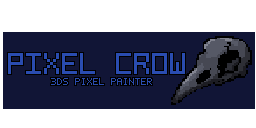

# Pixel Crow



Homebrew pixel-art / UI drawing app for the New 3DS (formerly "Pixel UI Designer"), written in C with
libctru + citro2d. See [docs/BRIEF.md](docs/BRIEF.md) for the plan.

## Home screen
The app opens on **Home** (also START → Home). START on Home exits the app:
- **New** tab: tap a canvas size twice (or A) to start, or Custom.
- **Gallery** tab: thumbnails of saved projects, newest first (a recovered autosave shows first).
  Tap to select, tap again or A to open; drag to scroll. Buttons: Open, Rename, Copy, Delete, Export
  (PNG with your export sizes). X deletes, Y renames, L/R switch tabs, B goes to the canvas.

## Controls
| Input | Action |
|---|---|
| Stylus on canvas | Use the current tool |
| Tap a swatch | Draw with that color; tap the selected one again to edit it (color square + hue bar, hex, or **Palette text** to type all swatches). Editing a swatch never changes the drawing |
| START → Linked swatches | Per project. On: editing a swatch also recolors every pixel of that color (like Aseprite's indexed mode). Off by default |
| Hold R + tap a swatch | Save the current color (e.g. from the eyedropper) into that swatch |
| A | Tool options (size 1–9, brush Square/Round/Dither, pixel-perfect, outline/filled, fill mode, mirror axis) |
| D-pad up/down | Previous / next tool: Pencil, Eraser, Fill, Shade, Line, Rectangle, Ellipse, Select, Stamp, Text, Eyedropper. Last entry **Mirror** opens Mirror On/Off + axis; while it's open, touch the canvas to move the mirror line. Applies to all drawing tools and stamps. Eraser has a Line mode |
| Fill tool | Mode (A): Connected area, Replace color, or Gradient: drag to fade the current color into the area with a 4x4 dither |
| Shade tool | Paint over pixels to make them one shade lighter or darker. A: direction; Using *Nearest swatch* (the closest swatch that is really lighter/darker - works on any color) or *Brightness* (same hue, brighter/darker); brush |
| Line tool | A: Mode Straight or **Curve**: drag the line, then touch and drag anywhere to bend it (B / L cancels). Size 1 curves are pixel-perfect |
| Select tool | Mode (A): Rectangle, Magic wand (tolerance 0-100%, connected or all of a color, samples all visible layers or the current one), Lasso. Combine: New / Add / Subtract. Tap inside a selection = new selection, drag inside = move it. Actions: Transform, select all, deselect, invert, copy, cut, paste, delete, flip, rotate 90, outline, crop canvas, save as stamp. B deselects (or applies a transform). The selection stays when you switch tools and drawing stays inside it |
| Transform (anything floating: moved/pasted selections, stamps, text) | Corner handles resize proportionally (hold ZR while dragging to stretch freely), edge handles stretch one way, the blue dot rotates (ZR: 15 degree steps), drag inside to move. Always resamples from the original pixels; "Crisp sizes" snaps to whole multiples. B or tapping outside applies it |
| Stamp tool | A: pick a stamp. Touch to place it, then use the transform handles; tapping outside places it and starts the next one |
| Hold R + stylus | Eyedropper |
| Press ZR while dragging a shape | Snap: square/circle; lines to 0°, 45°, 90° and 2:1 (ZR held *before* touching pans instead) |
| B while dragging a shape | Cancel the shape |
| L / ZL | Undo / redo |
| D-pad right/left | Zoom in / out (¼x to 24x) |
| B | Toggle eraser (back to your previous tool on the next press). In Select it deselects; while dragging a shape it cancels |
| Circle pad | Pan (or hold ZR, then touch and drag the canvas) |
| X | **Frames** panel (animation, top screen): left/right pick a frame, up/down change its duration (10 ms steps, hold to repeat), L/R move the frame, Y duplicate, SELECT play/stop, A = new blank / duplicate / delete frame, link the layer's cel to the previous frame (one drawing in both) or unlink, exact duration, FPS for all frames, tags (new, starts/ends here, direction forward/reverse/ping-pong, rename, delete), play all frames or one tag. B or X closes |
| Frame bar (bottom of the touch screen, 2+ frames) | ◀ / ▶ previous / next frame, tap *n / N* for the Frames panel, **+** duplicate the frame, **Onion** toggles onion skin (previous frame red, next blue), ▶ / ❚❚ plays on the top screen |
| Y | Layers (with thumbnails): up/down pick, X show/hide, left/right opacity, L/R move, A = new layer/folder, duplicate, delete, move, merge down/visible, lock, rename, collapse folder |
| Bottom row of the palette strip | Recent colors (tap to reuse) |
| SELECT | Top screen: tools/info ↔ big preview at 1x, 2x, 3x… (plays the animation when there are 2+ frames) |
| START | Menu: Home (new / gallery), save, save as, import PNG, export (PNG, sprite sheet, PNG per frame, animated GIF; all frames or one tag), canvas size (with anchor), shift layer, Colors (ramp between swatches, adjust hue/saturation/brightness/invert), View (pixel grid, onion skin on/off, frames 1–3 each side, opacity, flip preview, 3x3 tile preview, HUD grid, isometric grid, autosave), linked swatches, exit |

Projects are saved to `/3ds/pixel-crow/projects/*.pxd` ([format](docs/PXD.md)),
stamps to `/3ds/pixel-crow/stamps/`, PNG exports to `/3ds/pixel-crow/export/`,
and PNGs to import go in `/3ds/pixel-crow/import/`
(named `<project>_<W>x<H>.png`; sheets `<project>_sheet_<N>x.png`, frames `<project>_<N>x_001.png`…,
GIFs `<project>_<N>x.gif`, with the tag name added when you export one tag) — grab them with ftpd.

## Install
In FBI: *Remote Install → Scan QR Code*, then scan this. It always points at the
newest release's `.cia`.


Link: https://github.com/murphy97alex/Crow-3ds-Design/releases/latest/download/pixel-crow.cia
 Or copy the `.3dsx` to `/3ds/` on the SD
card and launch it from the Homebrew Launcher.

## Build
Needs devkitPro with `3ds-dev` (devkitARM, libctru, citro2d).

```sh
make          # .3dsx
make cia      # .cia (needs bannertool + makerom on PATH; scripts/fetch-tools.sh gets them)
```

CI builds every push; pushing a `v*` tag publishes a GitHub release with both files.

## License
MIT. Icon and banner art by Alex (murphy97alex), CC0 1.0. The default palette is CC0 ([details](docs/PALETTE.md)). Fonts: see [docs/FONTS.md](docs/FONTS.md)
(Tom Thumb, PICO-8, Kenney Pixel and the Crow fonts are CC0; Spleen is BSD 2-Clause,
[license](fonts/LICENSE-spleen.txt)). The banner sound is an original placeholder generated for this repo.
