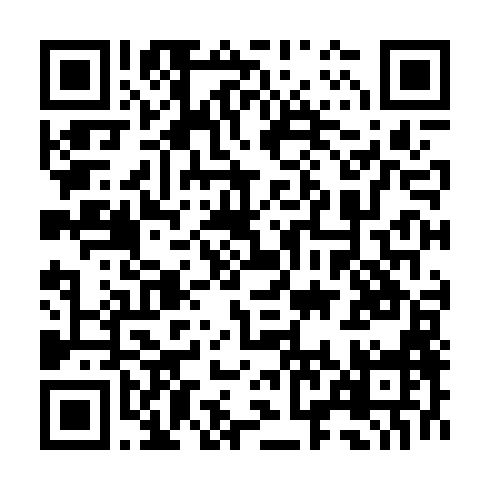

# Pixel UI Designer (3DS)

Homebrew pixel-art / UI drawing app for the New 3DS, written in C with
libctru + citro2d. See [docs/BRIEF.md](docs/BRIEF.md) for the plan.

## Controls
| Input | Action |
|---|---|
| Stylus on canvas | Use the current tool |
| Tap a palette swatch | Pick that color; tap the selected one again to edit it (wheel, brightness bar, hex) |
| A | Tool options (size 1–9, brush Square/Round/Dither, pixel-perfect, outline/filled, fill mode, mirror) |
| D-pad left/right | Previous / next tool: Pencil, Eraser, Fill, Line, Rectangle, Ellipse, Eyedropper |
| Hold R + stylus | Eyedropper |
| Hold ZR while dragging a shape | Snap: square/circle; lines to 0°, 45°, 90° and 2:1 |
| B while dragging a shape | Cancel the shape |
| L / ZL | Undo / redo |
| D-pad up/down | Zoom in / out |
| Circle pad | Pan |
| X | Grid on/off (zoom 4x and up) |
| Y | Switch to last-used tool |
| SELECT | Top screen: tools/info ↔ big preview at 1x, 2x, 3x… |
| START | Menu: new canvas (presets + custom), save, save as, open, exit |

Projects are saved to `/3ds/pixel-ui-designer/projects/*.pxd` ([format](docs/PXD.md)).

## Install
In FBI: *Remote Install → Scan QR Code*, then scan this. It always points at the
newest release's `.cia`.



Link: https://github.com/murphy97alex/Crow-3ds-Design/releases/latest/download/pixel-ui-designer.cia
 Or copy the `.3dsx` to `/3ds/` on the SD
card and launch it from the Homebrew Launcher.

## Build
Needs devkitPro with `3ds-dev` (devkitARM, libctru, citro2d).

```sh
make          # .3dsx
make cia      # .cia (needs bannertool + makerom on PATH; scripts/fetch-tools.sh gets them)
```

CI builds every push; pushing a `v*` tag publishes a GitHub release with both files.

## License
MIT. Icon, banner and banner sound are original placeholders generated for this repo.
