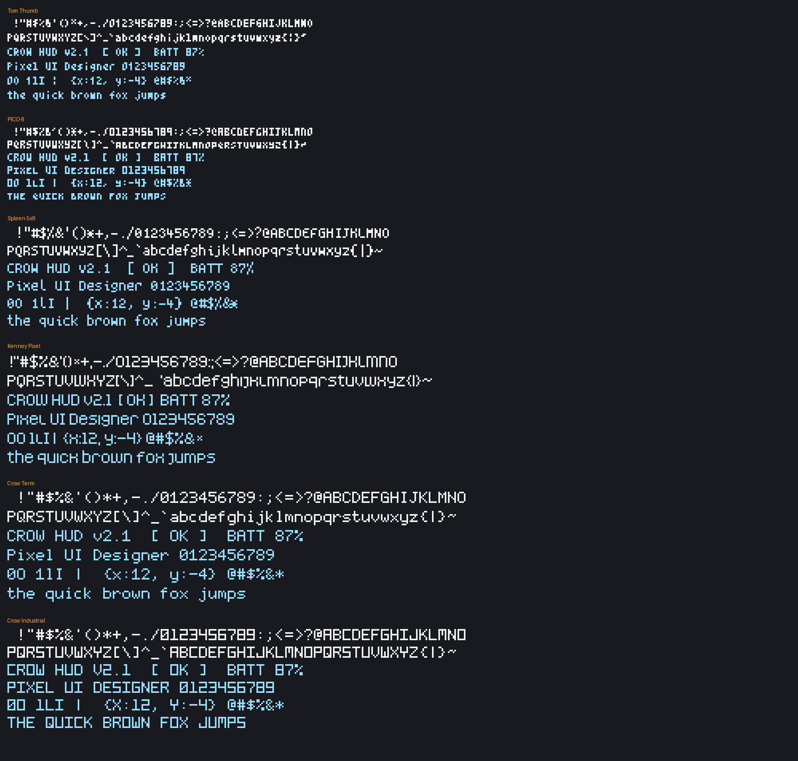

# Fonts in the Text tool



| Font | Size | Author | License | Source file |
|---|---|---|---|---|
| Tom Thumb | 3×5 (4×6 cell) | Brian Swetland, modified by Robey Pointer | CC0 (relicensed 2015; earlier copies say MIT) — https://robey.lag.net/2010/01/23/tiny-monospace-font.html | `fonts/tom-thumb.bdf` |
| PICO-8 | 3×5 | Lexaloffle (Zep) | CC0 (per the PICO-8 FAQ) | `fonts/pico8-font.png` (sheet via the MIT-licensed `embedded-picofont` crate) |
| Spleen 5×8 | 5×8 | Frederic Cambus | BSD 2-Clause — see [`fonts/LICENSE-spleen.txt`](../fonts/LICENSE-spleen.txt) | `fonts/spleen-5x8.bdf` |
| Kenney Pixel | ~5×9, proportional | Kenney (www.kenney.nl) | CC0 — see [`fonts/LICENSE-kenney.txt`](../fonts/LICENSE-kenney.txt) | `fonts/kenney-pixel.ttf` |
| Crow Term | 5×7 (+2 descender) | this project | CC0 1.0 | `tools/crow_fonts.py` |
| Crow Industrial | 5×7, capitals | this project | CC0 1.0 | `tools/crow_fonts.py` |

Spleen's license asks that binary distributions reproduce its copyright notice and license;
`fonts/LICENSE-spleen.txt` is that text, and this page links it from the project README.

The fonts are converted to `source/fonts_data.c` by `tools/fontgen.py` (needs Pillow), and this
preview is drawn by `tools/fontpreview.py` from the same data:

```sh
python3 tools/fontgen.py && python3 tools/fontpreview.py
```

To tweak a Crow font, edit its glyph grids in `tools/crow_fonts.py` and run both scripts again.
