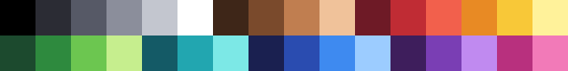

# Default palette

The 32 colors new projects start with were made for this project and are dedicated to the
public domain under **CC0 1.0 Universal**
(https://creativecommons.org/publicdomain/zero/1.0/). Use them for anything, no credit needed.



Row 1: grays (black to white), skin/browns, reds, oranges/yellows.
Row 2: greens, teals, blues, purples, pinks.

Hex list (also in [`assets/default-palette.hex`](../assets/default-palette.hex), one code per line,
the same format Lospec uses):

```
000000 2B2C34 565966 8B8E9B C3C6CF FFFFFF 3E2618 7A4A2C C07E50 F0C29A 6E1A26 C02C34 F2604C E88A24 F8C838 FFF29A
1C4A2E 2E8A3E 6CC650 C6EE8E 145A66 22A6B0 7CE8E6 1A2050 2A4CB0 3E8AF0 9CCCFF 3E1E5C 7A3EB4 C08AF0 B8307E F27AB8
```

Tip: on the 3DS, tap the selected swatch → **Palette text...** to paste a list like this and
replace the whole project palette at once.
